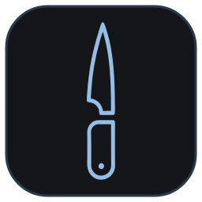
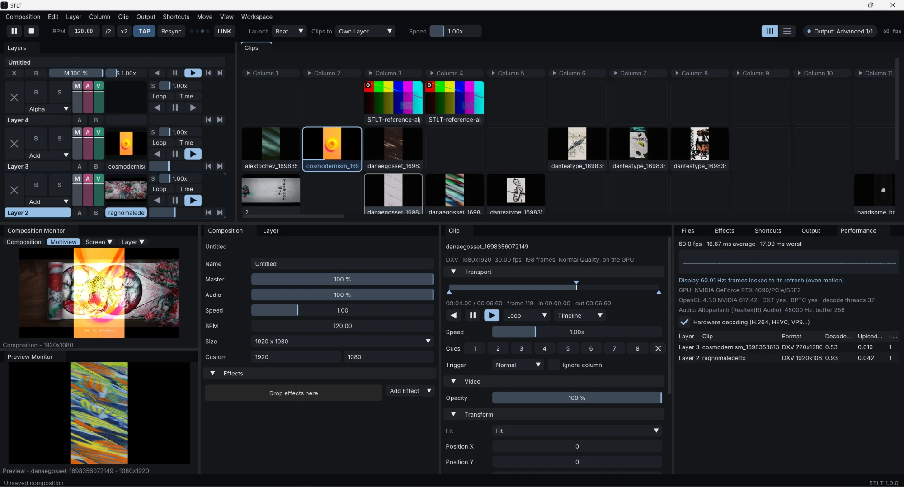
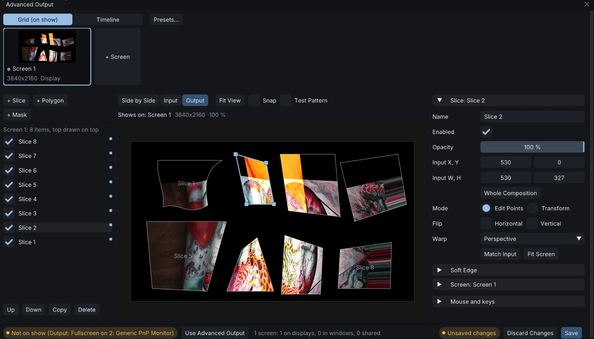
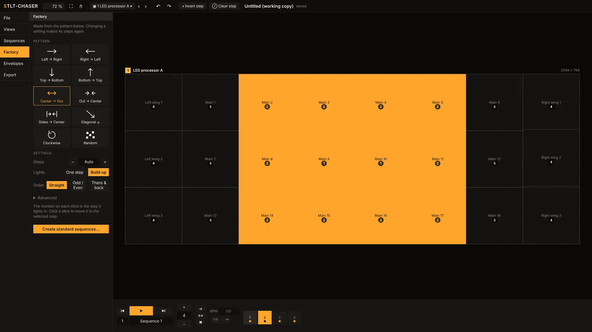
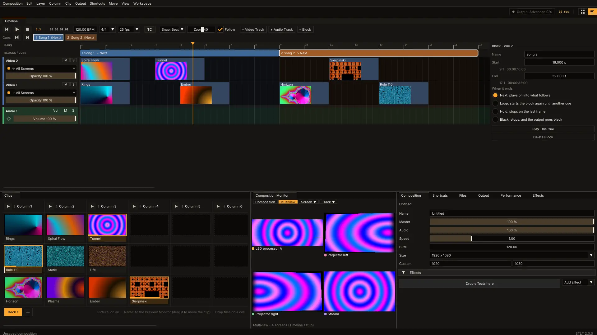
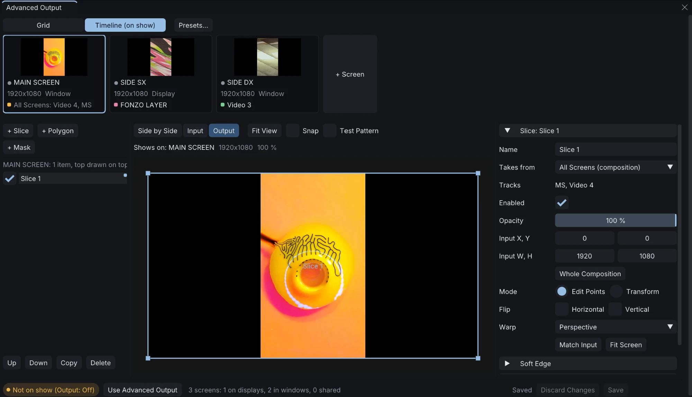

# STLT

**STLT è un software per VJ e installazioni visive multimediali.** È gratuito e open source, ed è fatto di due parti fondamentali, a un clic l'una dall'altra:

- **La Grid**, per suonare dal vivo: un software da VJ classico, con layer su cui lanciare i file sul momento e con velocità.
- **La Timeline**, per costruire uno show in anticipo: tracce video e audio, blocchi e cue, da mandare poi in diretta perfettamente a tempo con i musicisti, gli attori, i registi o lo spettacolo.

Si passa dall'una all'altra con le due icone in alto a destra (o col tasto Tab). Ognuna tiene la sua disposizione dei pannelli e la sua configurazione delle uscite, e tutte e due usano le stesse clip e gli stessi effetti.

> 🇬🇧 **[Read this page in English](README.md)**

**[Scarica STLT](https://github.com/alfonsostillet/STLT/releases/latest)** per Windows, macOS (Apple Silicon) o Linux.

> **Cercasi utenti Mac.** La versione per macOS viene compilata in automatico ma **non è mai stata provata su un Mac vero**. Se puoi provarla, ogni riscontro è molto gradito, anche solo "si apre" o "non si apre": [apri una segnalazione](https://github.com/alfonsostillet/STLT/issues).

## La Grid: suonare dal vivo



- **Layer, colonne e deck**: lanci una clip, una colonna intera oppure la clip precedente e successiva. I deck sono pagine di clip sugli stessi layer, e cambiare deck non ferma mai quello che sta suonando.
- **Crossfader A/B** e, su ogni layer, blend mode, fader separati per master, audio e video, velocità, bypass e solo.
- **Il tuo spazio di lavoro**: ogni pannello si sposta, si aggancia, si mette a schede, si divide o diventa una finestra su un altro monitor. Le disposizioni si salvano con un nome.
- **Controllo su tutto**: catene di effetti sulla composizione, su un layer o su una singola clip, ognuno con il suo mix.
- **Una moltitudine di effetti**: effetti e sorgenti integrati, circa 200 shader ISF e plugin FFGL 2, compresi quelli della cartella *Extra Effects* di Resolume.
- **Qualsiasi parametro si anima**: a tempo di BPM, su una durata in secondi o seguendo il suono in ingresso (livello, bassi, medi, alti).
- **Monitor multiview**: la composizione, tutti gli schermi affiancati, un solo schermo o un solo layer. Un Preview Monitor a parte fa vedere una clip prima di mandarla in uscita.
- **Clip**: punti di in e out, 8 cue point, BPM Sync, trigger Normal, Toggle e Piano, transizioni, lancio al prossimo beat o alla prossima battuta, audio a tempo con l'immagine.
- **Mappatura da tastiera, MIDI e OSC**, con preset da salvare e portare su un altro computer. I pad mappati si illuminano sul controller, a colori sull'Akai APC mini mk2.

### Slice su più schermi



L'**Advanced Output** porta il video su qualsiasi palco: tutti gli schermi che servono, slice e poligoni di qualsiasi forma, warp prospettico, a griglia, a griglia curva e a contorno Bézier, maschere, soft edge per fondere i proiettori, test pattern e preset. Importa anche l'`AdvancedOutput.xml` di Resolume.

### STLT-CHASER incluso



Bump, chase, tendine, ritardi e contorni sulle tue slice. *Output → Chaser...* apre l'editor sulle slice dell'Advanced Output, e gli effetti STLT-CHASER, STLT-WIPER e STLT-OUTLINER sono nel pannello Effects. Ogni sequenza è un pulsante che puoi mappare su un pad MIDI o un tasto, per cambiare sequenza dal vivo.

È costruito intorno a **[STLT-CHASER](https://github.com/alfonsostillet/stlt-chaser)**, il nostro plugin gratuito per Resolume, e funziona allo stesso modo. **Per le istruzioni fai riferimento alla guida del plugin per Resolume**: [italiano](https://github.com/alfonsostillet/stlt-chaser/blob/main/docs/GUIDA.md), [English](https://github.com/alfonsostillet/stlt-chaser#readme).

## La Timeline: costruire uno show



Qui crei uno show da zero e poi lo mandi in diretta, agganciato a chi guida lo spettacolo.

- **Tracce video e audio**, come in un programma di montaggio: trascini le clip dalla Grid, da Files o dal desktop, poi le sposti, le copi, le accorci e le tagli. Le tracce si rinominano e si riordinano, ognuna con mute e solo.
- **Keyframe** su opacità, posizione, scala, rotazione e volume, effetti su ogni clip e una linea del volume sulle tracce audio.
- **Tracce sugli schermi**: ogni traccia video va su tutti gli schermi o su uno solo, per esempio lo schermo centrale su una traccia e quelli laterali su altre.

### I blocchi

La **traccia dei blocchi** divide lo show nei suoi pezzi, di solito le canzoni. Ogni blocco dice cosa succede quando finisce:

| Alla fine del blocco | Cosa succede |
| --- | --- |
| **Next** | prosegue con quello che viene dopo |
| **Loop** | ricomincia da capo, finché non decidi di cambiare blocco |
| **Hold** | si ferma sull'ultimo fotogramma |
| **Black** | si ferma e l'uscita va a nero |

Così è lo show ad aspettare chi è sul palco, e non il contrario. Ogni blocco è un **cue**: ci vai col suo pulsante o con le frecce, oppure lo mappi su un tasto, un controllo MIDI o un messaggio OSC.

### A tempo con tutto

- **Timecode**: la timeline segue **LTC**, **MTC** e **Art-Net**, parte, si ferma e salta con lui, da un banco audio, un DAW o una console luci.
- **Tempo**: **Ableton Link** e **MIDI clock**, con un ritardo regolabile per i proiettori e i LED che mostrano l'immagine in ritardo. I CDJ Pioneer si agganciano attraverso PRO DJ LINK Bridge di Pioneer.



La Timeline ha la sua **configurazione dell'Advanced Output**, separata da quella della Grid, così gli schermi di uno show non toccano la tua mappatura dal vivo. Ogni schermo mostra le tracce che riceve.

## E poi

- **Riproduzione veloce**: HAP e DXV 3 vanno direttamente alla scheda video, con salti istantanei a qualsiasi frame. Suonano anche H.264, HEVC, ProRes, DNxHD, VP9, PNG, JPEG, GIF e altri, con la decodifica hardware dove c'è.
- **Il video verso altri programmi**: **Spout** (Windows), **Syphon** (macOS) e **NDI** in rete, schermo per schermo.
- **Movimento regolare**: l'orologio dei fotogrammi si aggancia all'aggiornamento del display, e il pannello Performance mostra i tempi di ogni layer.
- **Annulla e ripeti** per tutto, anche per l'intero Advanced Output.

Tutto il resto, dalle scorciatoie agli indirizzi OSC fino alla conversione delle clip in HAP, è nella **[guida completa](app/README.md)** (in inglese).

## Installazione

Scarica il file per il tuo sistema dall'**[ultima release](https://github.com/alfonsostillet/STLT/releases/latest)**. I programmi non sono firmati, quindi la prima volta il sistema può avvisarti.

- **Windows**: estrai tutta la cartella e avvia `STLT.exe`. Se Windows ti avvisa, scegli *Ulteriori informazioni → Esegui comunque*.
- **macOS** (Apple Silicon, per ora non provato): estrai e sposta `STLT.app` dove vuoi. La prima volta aprila col tasto destro → *Apri*, oppure da *Impostazioni di Sistema → Privacy e sicurezza → Apri comunque*.
- **Linux** (compilato su Ubuntu 24.04): estrai e avvia `stlt`. Usa le librerie FFmpeg, GLEW e GTK 3 del sistema.

## Compilare

CMake 3.20+ e un compilatore C++17; i pacchetti per ogni sistema sono in [app/README.md](app/README.md#building). Clona con `--recursive` per avere anche STLT-CHASER.

```bash
cmake -S app -B app/build -DCMAKE_BUILD_TYPE=Release
cmake --build app/build --config Release --parallel
```

Ogni push compila le versioni per Windows, macOS e Linux ed esegue i test (GitHub Actions, *STLT app*); le build sono allegate a ogni esecuzione.

## Sostieni il progetto

STLT è gratuito. Se il progetto ti è piaciuto e vuoi sostenermi per i progetti futuri, se puoi, puoi [offrirmi un caffè](https://buymeacoffee.com/sud_stillet) ☕

<a href="https://buymeacoffee.com/sud_stillet"></a>

## Riconoscimenti e licenza

Questo progetto è stato creato anche grazie all'utilizzo di [Claude](https://claude.ai), l'AI di Anthropic.

STLT è un progetto indipendente. Non è affiliato a Resolume né ai produttori di altri prodotti, né approvato da loro.

GPL-3.0: vedi [LICENSE](LICENSE) e [THIRD_PARTY_NOTICES.md](THIRD_PARTY_NOTICES.md).
