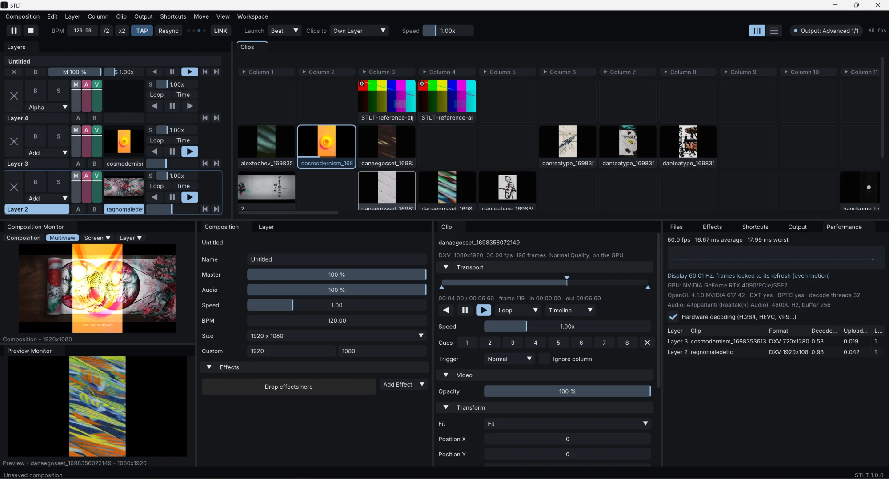
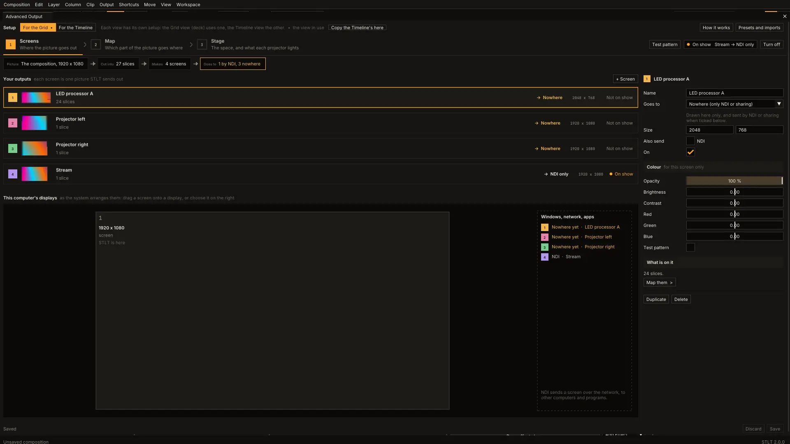
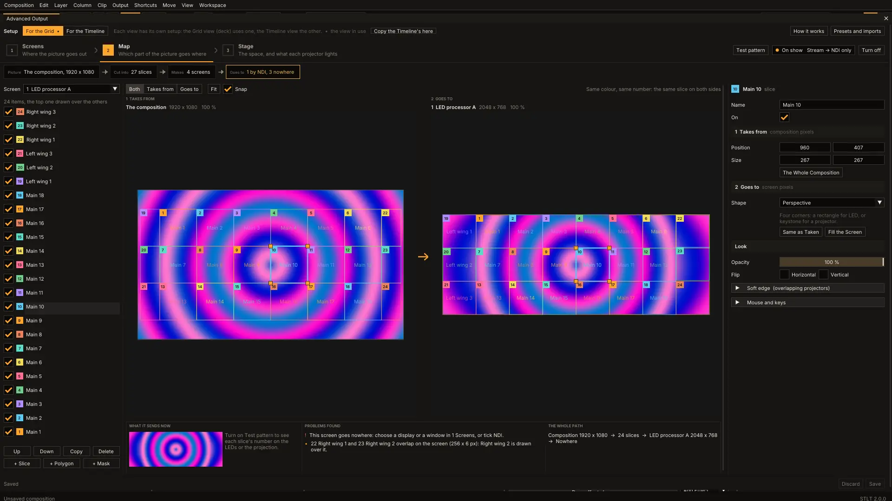
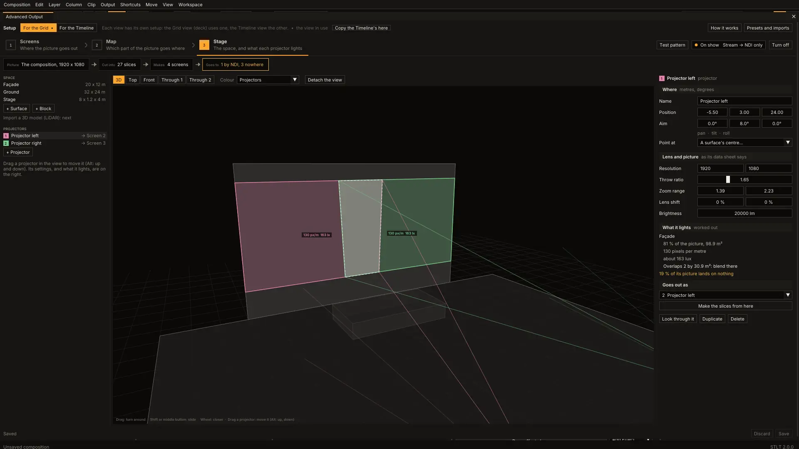
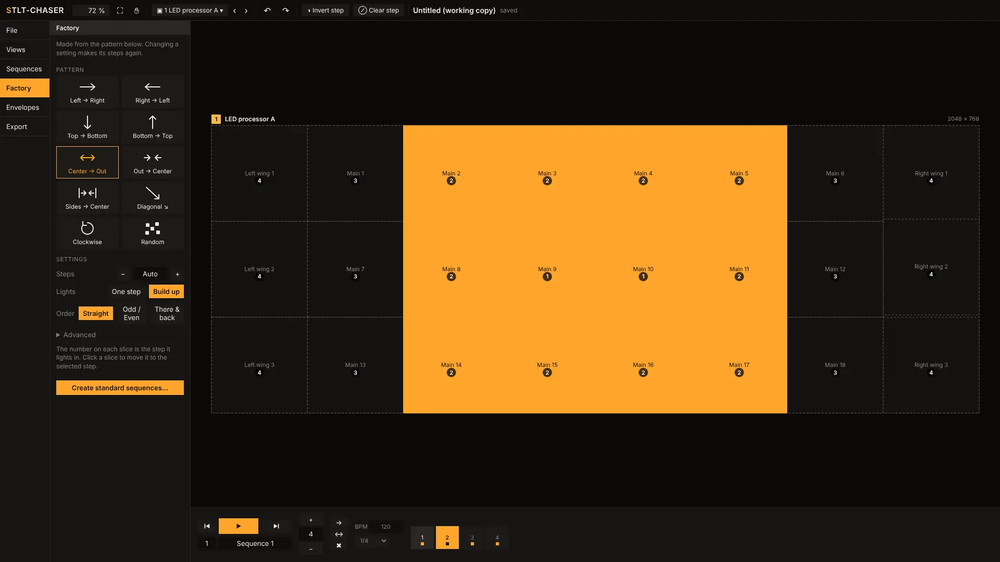
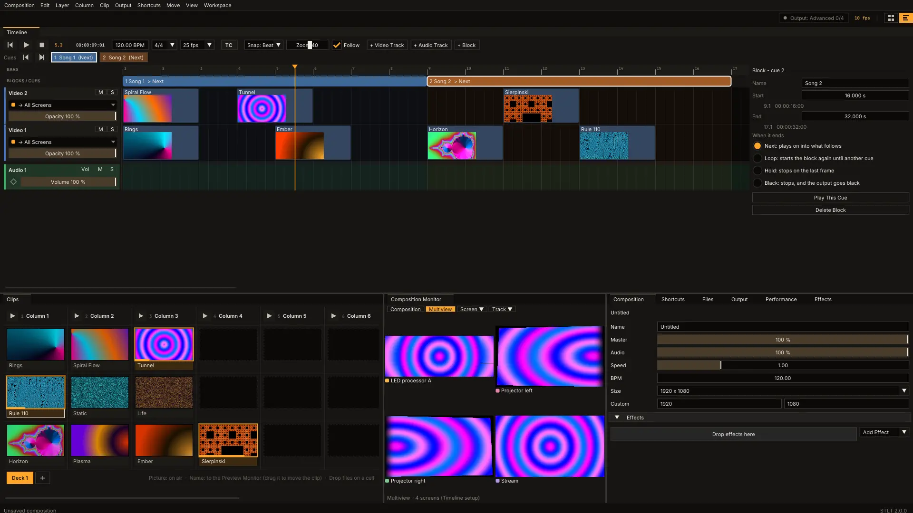

# STLT

**STLT is software for VJs and multimedia visual installations.** It is free and open source, and it is really two programs in one, a click apart:

- **The Grid**, for playing live: a classic VJ setup where you throw clips onto layers and launch them on the spot.
- **The Timeline**, for building a show in advance: video and audio tracks, blocks and cues, then played live in perfect sync with the musicians, the actors, the director or the show.

Switch between them with the two icons at the top right (or the Tab key). Each one keeps its own panel layout and its own output setup, and both work with the same clips and effects.

> 🇮🇹 **[Leggi questa pagina in italiano](README.it.md)**

**[Download STLT](https://github.com/alfonsostillet/STLT/releases/latest)** for Windows, macOS (Apple Silicon) or Linux.

> **Mac users wanted.** The macOS version builds automatically but **has never been tested on a real Mac**. If you can try it, any feedback is very welcome, even just "it opens" or "it doesn't": please [open an issue](https://github.com/alfonsostillet/STLT/issues).

## New in 2.0

- **A new interface**, warm and dark (the *Ember* look), with the deck drawn in blocks and the whole interface zoomable.
- **The Advanced Output in three steps**: *Screens* (where the picture goes out), *Map* (which part of the picture goes where) and **Stage**, a 3D view of the place in metres with the projectors where they will really stand.
- **A fuller Output menu**: fullscreen or a window on each display, composition sharing over NDI and Spout/Syphon, identify displays, a test card and a snapshot to PNG.
- **Maps that follow the selection**: a key or a MIDI control can act on a fixed layer or clip, or on whichever layer or clip is selected.
- **STLT-CHASER** in the same look, with a screen picker: all the screens side by side, one screen, or the composition.

## The Grid: playing live



- **Layers, columns and decks**: launch a single clip, a whole column or the next and previous clip. Decks are pages of clips over the same layers, and changing deck never stops what is playing.
- **A/B crossfader**, and on every layer blend modes, separate master, audio and video faders, speed, bypass and solo.
- **Your own workspace**: every panel can be moved, docked, tabbed, split or pulled out as a window onto another monitor. Layouts are saved by name.
- **Zoom the whole interface**: *View → Zoom In / Zoom Out* (Ctrl + and Ctrl −, Ctrl 0 for 100 %) makes everything bigger or smaller, so it reads well on a 13" laptop and on a 27" monitor alike.
- **Control over everything**: effect chains on the composition, on a layer or on a single clip, each with its own mix.
- **Lots of effects**: built-in effects and sources, about 200 ISF shaders, and FFGL 2 plugins.
- **Animate any parameter**: to the BPM, over a time in seconds, or following the sound coming in (level, bass, mid, treble).
- **Multiview monitor**: see the composition, all the screens side by side, a single screen or a single layer. A separate Preview Monitor plays a clip before it goes out.
- **Clips**: in and out points, 8 cue points, BPM Sync, Normal, Toggle and Piano triggers, transitions, launching on the next beat or bar, and sound in step with the picture.
- **Keyboard, MIDI and OSC mapping**, with presets you can save and carry to another computer. Each map acts **by position** (always layer 2, always that clip) or **on the selection** (the selected layer, the selected clip), so eight faders on a controller can drive whichever layer you are looking at. Mapped controller pads light up, in colour on the Akai APC mini mk2.

## The Advanced Output: from the picture to the place

The **Advanced Output** maps your video onto any stage, in three steps. A strip under the steps always shows the whole path: the picture, the slices it is cut into, the screens they make, and where each screen goes.

### 1. Screens: where the picture goes out



Each screen is one picture STLT sends out: drag it onto one of your displays, give it a window, or send it over the network by **NDI** and to other programs through **Spout** (Windows) or **Syphon** (macOS). STLT asks before covering its own display.

### 2. Map: which part goes where



What a slice **takes** from the composition and where it **goes** on its screen, side by side, in the same colour and with the same number. Slices and polygons of any shape, perspective, grid, curved grid and Bézier contour warps, masks, soft edges for blending projectors, test patterns and presets. STLT points out the problems it finds (a screen that goes nowhere, two slices overlapping on an LED wall), and it can import Resolume's `AdvancedOutput.xml`.

### 3. Stage: the place, in 3D



Plan a projection before you get to the place. Put in the surfaces at their real size in metres (a façade, walls, a floor, blocks), then the projectors where they will stand, as their data sheets give them: lens, zoom range, lens shift, lumens. STLT shows what each projector lights, how sharp (**pixels per metre**) and how bright (**lux**) it is there, where two projectors overlap, and how much of a picture lands on nothing. Look **through** a projector's lens, then **make the slices from there**: each surface it lights becomes a slice already in perspective, ready to fine tune on site.

The Grid and the Timeline each have **their own setup**, so a show's screens don't disturb your live mapping; one can be copied into the other.

### STLT-CHASER built in



Bumps, chases, wipes, delays and outlines across your slices. *Output → Chaser...* opens the editor on the slices of your Advanced Output, screen by screen or all together, and the STLT-CHASER, STLT-WIPER and STLT-OUTLINER effects are in the Effects panel. Each sequence is a button you can map to a MIDI pad or a key, to change sequence live.

It is built around **[STLT-CHASER](https://github.com/alfonsostillet/stlt-chaser)**, our free plugin for Resolume, and it works the same way. **For the instructions, follow the guide of the Resolume plugin**: [English](https://github.com/alfonsostillet/stlt-chaser#readme), [italiano](https://github.com/alfonsostillet/stlt-chaser/blob/main/docs/GUIDA.md).

## The Timeline: building a show



Here you create a show from scratch, then send it out live, locked to whatever leads the performance.

- **Video and audio tracks**, as in an editing program: drag on clips from the Grid, from Files or from the desktop, then move, copy, trim and split them. Rename and reorder the tracks, with mute and solo on each.
- **Keyframes** on opacity, position, scale, rotation and volume, with effects on every clip, and a volume line on the audio tracks.
- **Tracks to screens**: send each video track to all the screens or to one of them, for example the main screen on one track and the side screens on others.

### Blocks

The **block track** divides the show into its pieces, usually the songs. Each block says what happens when it ends:

| At the end of the block | What happens |
| --- | --- |
| **Next** | plays on into what follows |
| **Loop** | starts again from the top, until you decide to change block |
| **Hold** | stops on the last frame |
| **Black** | stops, and the output goes to black |

So the show waits for the people on stage, not the other way round. Every block is a **cue**: jump to it with its button or the arrow keys, or map it to any key, MIDI control or OSC message.

### In sync with everything

- **Timecode**: the timeline follows **LTC**, **MTC** and **Art-Net**, starting, stopping and jumping with it, from an audio desk, a DAW or a lighting desk.
- **Tempo**: **Ableton Link** and **MIDI clock**, with an adjustable delay for projectors and LED walls that show the picture late. Pioneer CDJs can join through Pioneer's PRO DJ LINK Bridge.

## Also inside

- **Fast playback**: HAP and DXV 3 go straight to the GPU, with instant jumps to any frame. H.264, HEVC, ProRes, DNxHD, VP9, PNG, JPEG, GIF and others also play, with hardware decoding where available; the Clip panel names the codec and suggests HAP or DXV when a clip would weigh on the processor.
- **The Output menu**: the whole composition fullscreen or in a window on any display, shared over NDI or Spout/Syphon, numbers on every display to tell them apart, a test card, and a snapshot to PNG.
- **Even motion**: the frame clock locks to the display's refresh, and the Performance panel shows the timing of every layer.
- **Undo and redo** for everything, including the whole Advanced Output.

Everything else, from shortcuts and OSC addresses to converting clips to HAP, is in the **[full guide](app/README.md)**.

## Install

Get the file for your system from the **[latest release](https://github.com/alfonsostillet/STLT/releases/latest)**. The programs are not signed, so your system may warn you the first time.

- **Windows**: extract the whole folder and start `STLT.exe`. If Windows warns you, choose *More info → Run anyway*.
- **macOS** (Apple Silicon, untested so far): extract it and move `STLT.app` wherever you like. The first time, right-click it and choose *Open*, or use *System Settings → Privacy & Security → Open Anyway*.
- **Linux** (built on Ubuntu 24.04): extract it and start `stlt`. It uses the system's FFmpeg, GLEW and GTK 3 libraries.

## Building

CMake 3.20+ and a C++17 compiler; see [app/README.md](app/README.md#building) for the platform packages. Clone with `--recursive` to get STLT-CHASER.

```bash
cmake -S app -B app/build -DCMAKE_BUILD_TYPE=Release
cmake --build app/build --config Release --parallel
```

Every push builds Windows, macOS and Linux versions and runs the tests (GitHub Actions, *STLT app*); the builds are attached to each run.

## Support

STLT is free. If you like the project and want to support future ones, you can [buy me a coffee](https://buymeacoffee.com/sud_stillet) ☕ if you are able to.

<a href="https://buymeacoffee.com/sud_stillet"></a>

## Credits and license

This project was also made possible by using [Claude](https://claude.ai), Anthropic's AI.

STLT is an independent project. It is not affiliated with or endorsed by Resolume or by the makers of any other product.

GPL-3.0: see [LICENSE](LICENSE) and [THIRD_PARTY_NOTICES.md](THIRD_PARTY_NOTICES.md).

## About this version

This is version 2.0: a new interface, and an Advanced Output rebuilt around the place you are projecting on. It will surely still have bugs. I wasn't able to try the Mac version; what I know for sure is that the Windows one works. If anyone would like to send me feedback, I'd be glad to hear it: [open an issue](https://github.com/alfonsostillet/STLT/issues). The 1.x interface stays on the [`classic-ui`](https://github.com/alfonsostillet/STLT/tree/classic-ui) branch.
