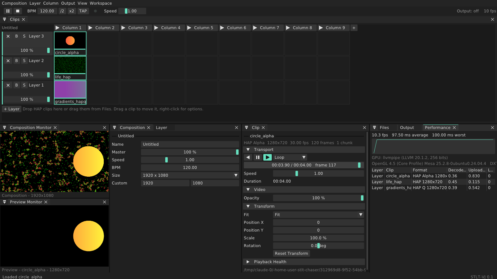
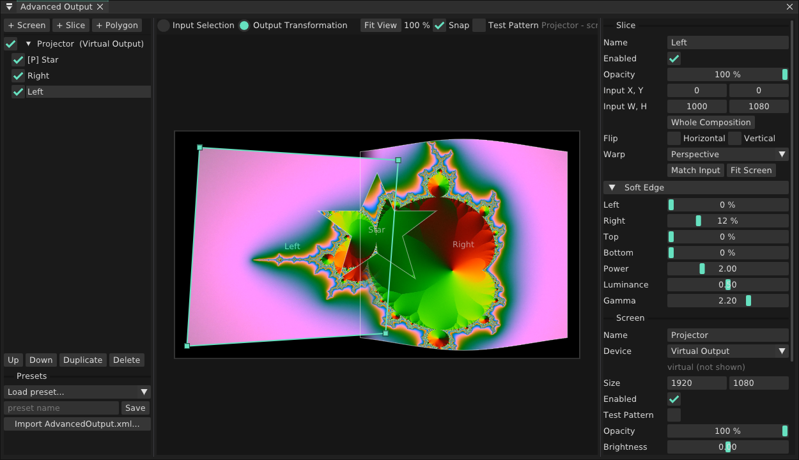
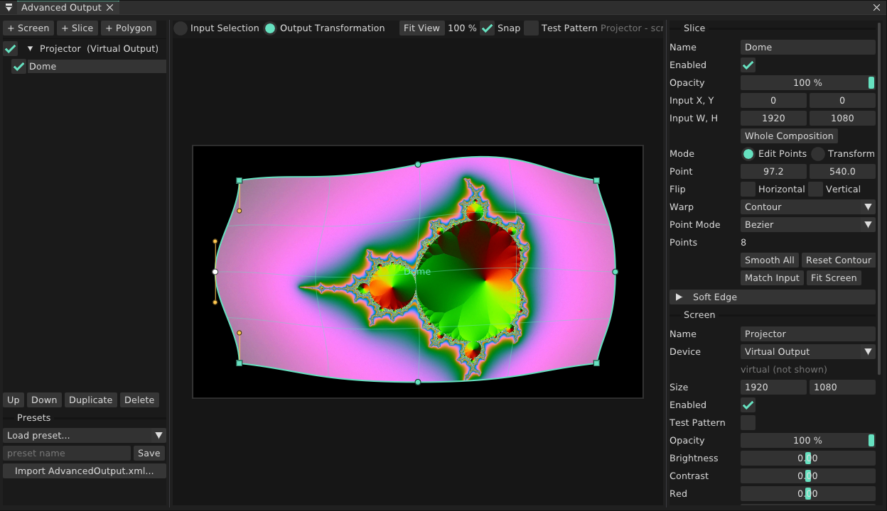

# STLT-VJ

A live video player built around HAP for speed, that also plays everything else (H.264, HEVC, ProRes, DXV, DNxHD, VP9, PNG, JPEG, GIF, ...), with a workspace you arrange yourself.
It is an independent project, written from public specifications (HAP, FFGL, OpenGL) and from how a VJ setup is used on stage. It is not affiliated with Resolume or any other product and contains none of their code or artwork.



> 🇮🇹 In breve: STLT-VJ riproduce clip su più layer con pannelli agganciabili e flottanti. Legge HAP (il formato più veloce) e anche H.264, ProRes, DXV, PNG, JPEG e gli altri formati comuni, ma **con HAP le prestazioni sono nettamente migliori**: decodifica 5 volte più veloce, salti istantanei a qualsiasi frame e quasi niente CPU (vedi *Performance: HAP or not*). Trascina i file sulla griglia, dal pannello Files o con *Composition → Import Media...* (selettore file del sistema), clicca una clip per lanciarla, clicca l'intestazione di una colonna per lanciare tutta la colonna. Dal pannello *Effects* trascina un effetto su una clip, sull'intestazione di un layer o sul Composition Monitor; trascina una *Source* su una cella vuota. I plugin FFGL (anche STLT-CHASER) vengono caricati dalla cartella *Extra Effects* di Resolume. Click destro su un parametro per animarlo a tempo di BPM. *Output → Advanced Output...* (Ctrl+Shift+A) apre l'editor di mappatura: più screen (display, finestra o virtuali), slice e poligoni con selezione dell'input, warp a 4 punti, griglia lineare o curva per superfici piegate, *Contour* per adattare il contorno dello slice alla superficie reale punto per punto (Edit Points, con Point Mode Bezier o Linear a destra, doppio clic sul contorno per aggiungere un punto) o tutto insieme (Transform: scala e ruota), soft edge per la fusione tra proiettori, maschere (rettangolo o ellisse, anche invertite e sfumate), test pattern, preset e import dell'`AdvancedOutput.xml` di Resolume (anche warp, soft edge e maschere). *Workspace → Save Workspace As...* salva la disposizione dei pannelli.

## What works now

- **HAP playback**: HAP, HAP Alpha, HAP Q, HAP Q Alpha, HAP Alpha-Only; HAP R and HAP HDR where the GPU driver has BPTC (not on macOS). HAP, HAP Alpha and HAP Q are tested with real clips; the other variants follow the specification but have not been tried with real files yet.
- **Every other format** through FFmpeg: H.264, HEVC, ProRes, DXV, DNxHD, VP8/VP9, MPEG-4, Motion JPEG and more, in .mov, .mp4, .mkv, .avi, .mxf and similar files, plus still images (PNG with transparency, JPEG, BMP, TIFF, WebP) and animated GIFs. These play fine but cost far more than HAP: see below. The Clip panel marks clips that are not HAP.
- **Native file dialogs**: *Composition → Open / Save As / Import Media*, *Load Media...* on a clip cell, *Browse...* in the Files panel, plugin folders and FFGL file parameters use the system's own dialogs. On Windows they run beside playback, so the output never stops while one is open.
- **Deck**: layers × columns of clips with thumbnails. Click a clip to launch it, click a column header to launch the column, drag clips between cells, drop files from the desktop or the Files panel.
- **Layers**: opacity, blend modes (Alpha, Add, Screen, Multiply, Lighten, Darken, Difference, Subtract), bypass, solo.
- **Clips**: forward / reverse / pause, loop, bounce or play once, speed, timeline scrubbing, opacity, fit (Fit, Fill, Stretch, Native), position, scale, rotation.
- **Composition**: any size up to 16K, master, global speed, BPM with tap tempo.
- **Advanced Output** (*Output → Advanced Output...*, Ctrl+Shift+A): see below.
- **Workspace**: every panel can be docked, tabbed, split, or pulled out as its own window onto another monitor. Layouts are saved as named workspaces; the last layout and composition come back on the next start.
- **Performance panel**: frame time graph, decode and upload time per layer, late frames.
- **Effects**: chains on every clip, layer and on the composition, each effect with bypass, dry/wet mix and reordering (drag the headers or use the arrows). Drag effects from the Effects panel onto a clip cell, a layer name, the Composition Monitor or any effects list.
- **Built-in effects**: Brightness & Contrast, Hue & Saturation, Invert, Colorize, Threshold, Mirror, Kaleidoscope, Tile, Pixelate, RGB Split, Blur, Edge Detect, Strobe (beat-synced), Trails.
- **Sources** (generated clips, at the composition size): Solid Color, Gradient, Lines, Checker, and FFGL source plugins. Drop one on an empty cell.
- **FFGL 2 host**: loads `.dll` (Windows) and `.bundle` (macOS) effect and source plugins from the app's plugin folder, Resolume's *Extra Effects* folders and any folder you add (Effects → Plugin Folders). Parameters show as sliders, checkboxes, buttons, menus, text and colour pickers, grouped as the plugin asks; menus, names and visibility that change live (FFGL 2.2/2.3) update in the panel. Plugins get the BPM, bar phase and time. STLT-CHASER, STLT-WIPER and STLT-OUTLINER run here as they do in Resolume.
- **Beat-synced parameters**: right-click any parameter → Animate: saw, ping-pong, sine, square or random, over 1/4 to 64 beats, between two values. RESYNC restarts the beat.

## Advanced Output



- **Screens**: as many as you need, each fullscreen on a display (chosen by name, so it finds the projector again after a restart), in a window, or virtual. Per screen: resolution, opacity, brightness, contrast, red/green/blue, and a **test pattern** that draws every slice as a coloured grid with its frame and centre, for lining up projectors.
- **Slices**: a rectangle of the composition (*Input Selection*) placed on the screen (*Output Transformation*). **Polygons** take any shape of the composition and pin each point anywhere on the screen.
- **Warping**: *Perspective* (four corners, for keystone), *Grid* (any number of points joined by straight lines), *Curved Grid* (the same points joined by smooth curves, for bending onto curved or uneven surfaces) or *Contour* (below). Switching keeps the current shape; grids can be refined or flattened.
- **Contour** (Resolume's *Edit Points* on the output): the slice's outline is a chain of points you fit to the real surface, and the picture is stretched to fill it. Four corners alone give exactly the perspective warp; add points anywhere along the sides (double-click the outline, or right-click → *Add Point Here*) and drag them onto the edges of the screen, the arch, the column. *Point Mode* in the slice settings joins them with **Bézier** curves or **Linear** segments. In Bézier mode the selected point shows its two handles and its neighbours' facing ones: handles in line stay in line (Alt moves one alone), Alt-drag on a point pulls out fresh handles, double-click a point to switch it between smooth and straight, *Smooth All* rounds the whole outline, *Reset Contour* goes back to the four corners. Corners can't be deleted; other points go with Delete or right-click → *Delete Point*.
- **Edit Points / Transform** (slice settings, on the output): *Edit Points* drags single points; *Transform* puts a box around the slice to scale it from a side or corner (Alt: from the centre, Shift: keep proportions) and a knob above it to rotate it (Shift: 15° steps), for any warp or polygon.
- **Masks** (*+ Mask*: rectangle or ellipse): shapes that black out what lies below them in the list, or everything outside them when inverted, with a feather for a soft edge and a strength. Their points are edited like a contour (Bézier or linear, add, delete, smooth, Transform), so a mask can follow a doorway, a column or the edge of a screen.
- **Soft edge** on each side, with power, luminance and gamma, to blend overlapping projectors.
- **Editing**: drag a slice to move it, its points to shape it; polygons get new points by double-clicking their outline too (on either tab, the other side gets the matching point); rectangles stay rectangles on the input (Alt frees a corner); Shift locks an axis; handles snap to the canvas edges and centre and to the other slices (Ctrl to drop the snap); arrows nudge the selected point, or the whole slice when none is selected, by 1 pixel (Shift: 10); the selected point's exact position is in the slice settings; wheel zooms, middle button or Space pans; right-click a slice for Match Output to Input, Fit to Screen, flips. Flip, opacity, exact input position and size are in the slice settings.
- **Presets** of the whole setup, and **import from Resolume**: *Import from Resolume* reads Arena's or Avenue's `AdvancedOutput.xml` straight from Documents, or pick any file. Screens, slices (input and output rectangles), polygons and masks come across, with the slices' warp grids (linear as *Grid*, Bézier as *Curved Grid*) and soft edges. Resolume does not document this file: the importer reads the variants it knows and keeps the plain output rectangle for anything else, so check warped slices after an import (and send us the file if one comes out wrong).
- The setup is saved on exit and restored on start, independently of the composition.



Rendering: each slice is a fine triangle mesh that follows the warp, so perspective and curves stay smooth; the composition is sampled once per screen pixel, soft edges are computed per pixel, and each screen gets its own vsynced window.

## Performance: HAP or not

HAP is the format to use for a show. Other formats work, but every one of them costs more, in several ways:

| 1920x1080, same content, 4-core CPU | HAP | HAP Q | H.264 |
| --- | --- | --- | --- |
| Decoding, frames in order | **1.0 ms** | **1.4 ms** | 6.8 ms, on all four cores |
| Decoding, jumping to random frames (scrubbing, cue points, reverse) | **1.1 ms** | **1.3 ms** | 201 ms |
| Data sent to the GPU per frame | 1.0 MB | 2.1 MB | 3.1 MB |
| CPU left for other layers | nearly all | nearly all | little |

Measured with `decodebench` on clips made from the same 4-second source; your numbers depend on the machine and the encoding, the proportions do not. What it means on stage:

- **H.264, HEVC and other long-GOP codecs** only store a full picture every second or so. Playing forwards is fine for a layer or two, but jumping in a clip, scrubbing, playing backwards or bouncing has to decode from the previous full picture every time: slow, and visible as stutter. They also use most of the CPU, so several of them at once compete with each other.
- **ProRes, DNxHD and Motion JPEG** decode any frame on its own, so jumps are fine, but they are heavy on the CPU and large on disk.
- **DXV** (Resolume's codec) is decoded by FFmpeg on the CPU here, unlike HAP whose compressed textures go to the GPU as they are.
- **Still images** cost nothing after loading: they are decoded once.

Convert anything you play live to HAP (commands below). Everything else is fine for quick previews, tests and one-off clips.

## Why HAP plays fast here

HAP frames are GPU textures (DXT1/DXT5/BC7/BC6H) compressed once more with Snappy. The player never turns a frame into pixels on the CPU:

1. A decoder thread per playing clip reads the compressed frame with a positional read (the OS read-ahead keeps the disk streaming).
2. The frame's Snappy chunks are decompressed in parallel on a shared thread pool, **directly into a mapped OpenGL pixel buffer**: no intermediate copy.
3. The render thread unmaps the buffer and `glCompressedTexSubImage2D` hands it to the GPU by DMA, then orphans the buffer so it never waits for the upload.
4. The decoder runs up to three frames ahead in the play direction, so a slow frame does not cause a drop; a seek or a trigger decodes the new frame right away.
5. HAP Q's YCoCg and HAP Q Alpha's separate alpha plane are converted in the shader.

Encode clips with several chunks so step 2 can use every core (`-chunks 4` to `-chunks 16` in FFmpeg; Alley and AfterCodecs have the same option). Measured on 4 cores: a 4K HAP frame with 16 chunks decodes in 1.7 ms instead of 4.0 ms on one thread.

Other formats use the same pipeline from FFmpeg's output: YUV pictures go to the GPU as three planes and are converted to RGB in the shader (BT.601 or BT.709, video or full range, as the file says); only formats that are not planar YUV are converted on the CPU.

## Converting clips to HAP

```
ffmpeg -i input.mp4 -c:v hap -format hap_q -chunks 8 output.mov        # HAP Q: best quality
ffmpeg -i input.mp4 -c:v hap -format hap -chunks 8 output.mov          # HAP: smallest
ffmpeg -i input.mov -c:v hap -format hap_alpha -chunks 8 output.mov    # HAP Alpha: keeps transparency
```

Width and height must be multiples of 4.

## Shortcuts

| Key | Action |
| --- | --- |
| Space | Pause / resume everything |
| Ctrl+S / Ctrl+O | Save / open composition |
| Ctrl+I | Import media into the selected layer |
| Ctrl+Shift+A | Advanced Output editor |
| Double-click a slider | Reset it |
| Right-click a clip or column | Clip and column options |

## Building

CMake 3.20+ and a C++17 compiler (Visual Studio 2022, Xcode command line tools, or GCC/Clang with the X11 and GTK 3 development packages on Linux). GLFW, Dear ImGui, Snappy, HAP and Native File Dialog Extended are downloaded by CMake.

FFmpeg, for everything that is not HAP:
- **Windows**: CMake downloads a prebuilt FFmpeg 7.1 and copies its DLLs next to the executable.
- **macOS**: build a small, decode-only static FFmpeg once with `app/scripts/build-ffmpeg.sh ~/ffmpeg` and add `-DFFMPEG_ROOT=$HOME/ffmpeg` below.
- **Linux**: the system packages (`libavformat-dev libavcodec-dev libswscale-dev libavutil-dev`).
- `-DSTLTVJ_WITH_FFMPEG=OFF` builds a HAP-only app.

```
cmake -S app -B app/build -DCMAKE_BUILD_TYPE=Release
cmake --build app/build --config Release
ctest --test-dir app/build -C Release          # media and effect tests
app/build/decodebench clip.mov --random        # decode speed of any clip, no GPU needed
```

Command line options: `--fresh` (start empty and save nothing), `--clip LAYER,COLUMN,PATH` (load and launch a clip), `--source LAYER,COLUMN,EFFECT-ID` (a generated clip), `--fx comp|layer:L|clip:L,C=EFFECT-ID` (add an effect), `--launch LAYER,COLUMN` (play a clip of the restored session), `--list-effects` (print effect ids and plugins that did not load), `--output-setup FILE.json|AdvancedOutput.xml`, `--advanced-output input|output` (open the editor), `--size WxH`, `--capture FILE.bmp --frames N` (screenshot after N frames, then quit).

FFGL plugins are loaded from `plugins/` in the settings folder, `Documents/Resolume Arena/Extra Effects`, `Documents/Resolume Avenue/Extra Effects` and the folders listed in `plugin-folders.txt`. Only FFGL 2 effects and sources are loaded; mixers and multi-input effects are listed as skipped. A composition that uses a plugin this computer does not have keeps the plugin's settings and shows it as missing.

Settings live in `%APPDATA%\STLT-VJ`, `~/Library/Application Support/STLT-VJ` or `~/.config/stlt-vj`: `layout.ini` (current panel layout), `workspaces/` and `last-session.stltvj`.

## Code map

| Folder | What |
| --- | --- |
| `src/media` | QuickTime/MP4 demuxer, HAP frame decoding, thread pool, positional file reads. No OpenGL: tested headless. |
| `src/render` | Clip player (decode thread + pixel buffers + textures), GPU compositor with effect chains, output window. |
| `src/output` | Advanced output: screens, slices, warps, soft edges, Resolume import, and the renderer with its output windows. |
| `src/fx` | Effect parameters and beat animations, built-in GLSL effects and sources, the FFGL 2 host, the effect registry. |
| `src/ui` | Panels, theme, workspaces. |
| `src/App.*` | Main loop and the actions panels share (load, launch, move, save). |

## Next milestones

1. Advanced Output: Spout/Syphon/NDI outputs.
2. FFGL mixers as layer transitions, audio/FFT input for plugins that ask for it, clip parameter animation (opacity, transform).
3. MIDI and OSC mapping; hardware decoding (VideoToolbox, D3D11) for H.264 and HEVC.
